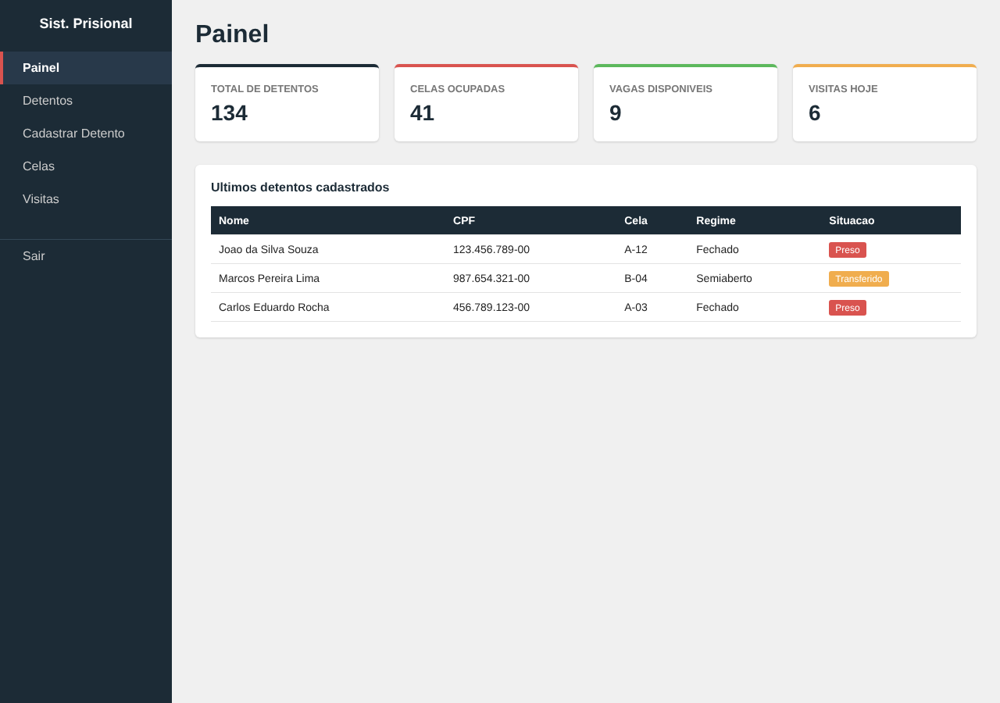
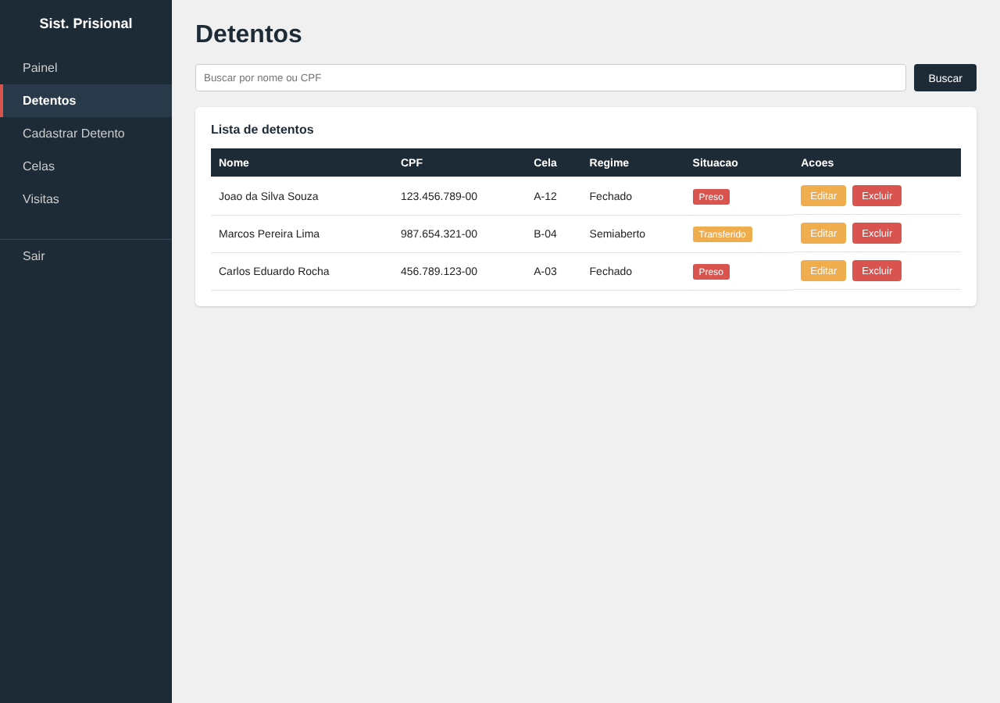
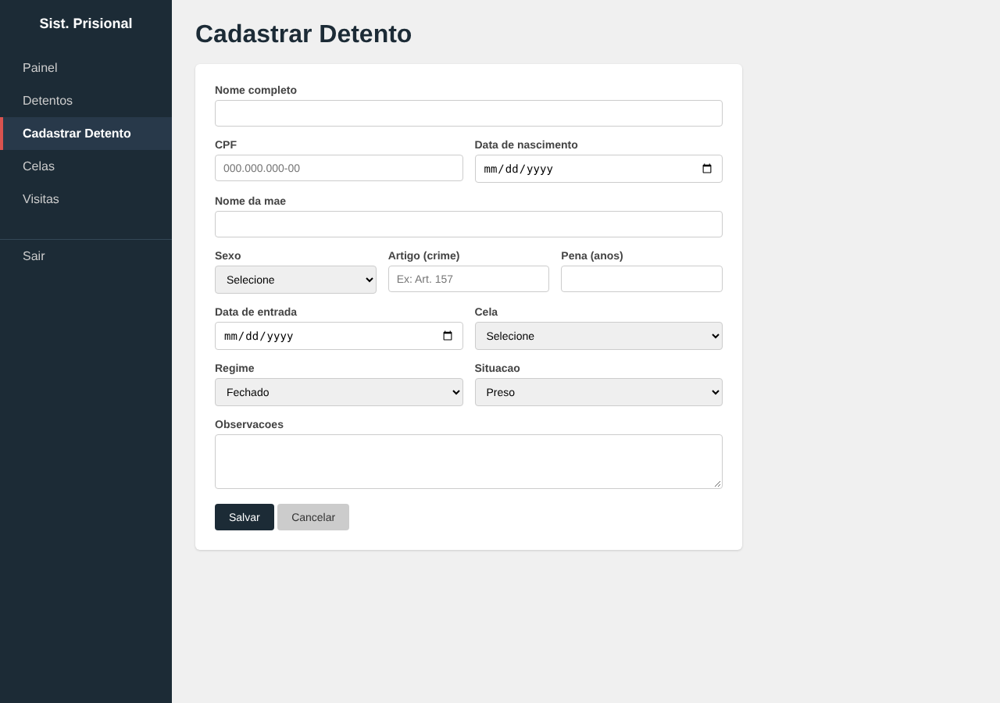
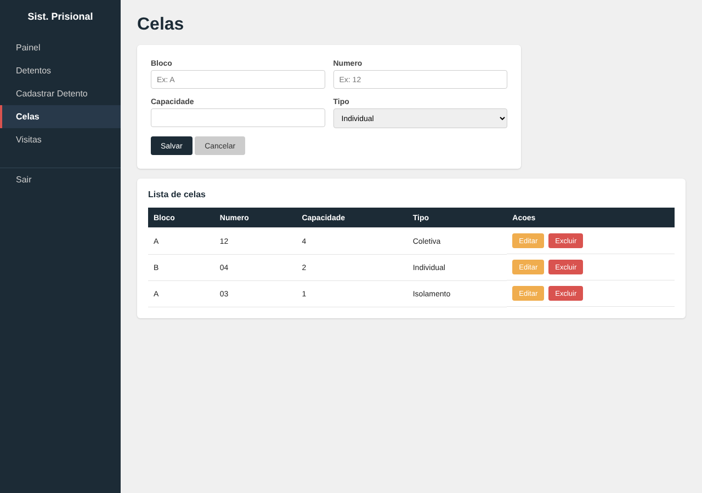
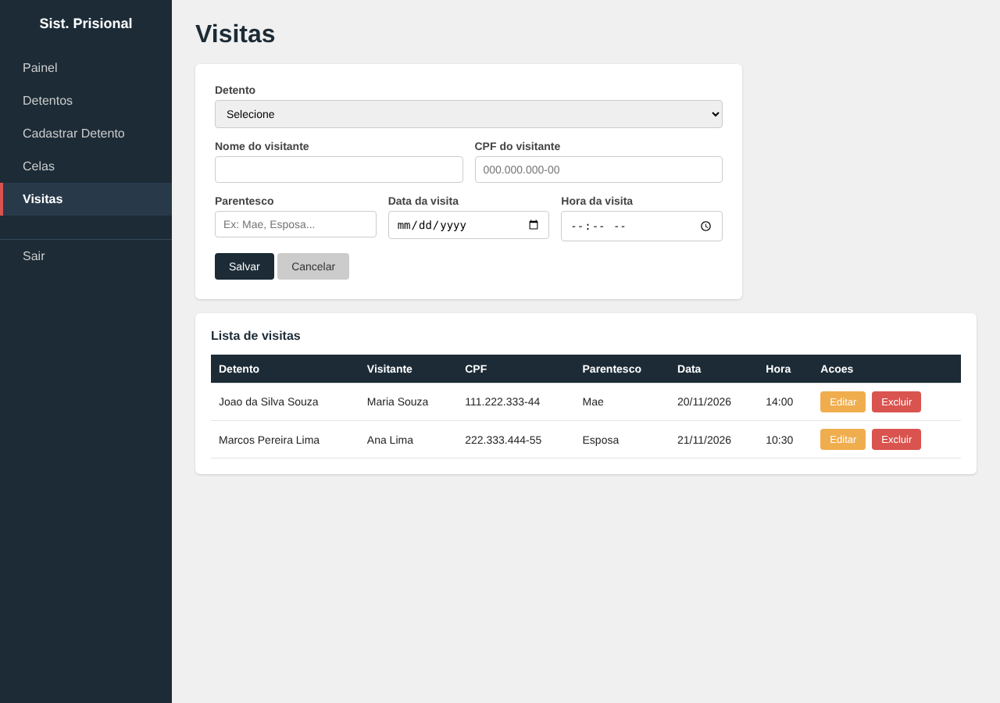

# SGP — Sistema de Gestão Prisional

Sistema web para a gestão de uma unidade prisional: cadastro e consulta de detentos, controle de celas e agendamento de visitas, com acesso restrito por login.

Projeto acadêmico em grupo da disciplina **Desenvolvimento Web em HTML5, CSS, JavaScript e PHP**, do curso de Análise e Desenvolvimento de Sistemas da Estácio (2026).

## Funcionalidades

- **Login** com senha criptografada (`password_hash` / `password_verify`)
- **Painel** com total de detentos, celas ocupadas, vagas disponíveis e visitas do dia
- **CRUD de detentos:** cadastrar, buscar por nome ou CPF, editar e excluir
- **Celas:** cadastro por pavilhão, número e capacidade
- **Visitas:** agendamento vinculado a um detento

## Tecnologias

| Camada | Stack |
| --- | --- |
| Front-end | HTML5 semântico, CSS3 (Flexbox, media queries), JavaScript (DOM e validação) |
| Back-end | PHP com PDO |
| Banco de dados | MySQL |
| Ambiente | XAMPP (Apache + MySQL) |

**Segurança:** prepared statements contra SQL Injection, senhas com hash e exclusão feita via POST com confirmação.

## Telas

| Login | Detentos |
| --- | --- |
|  |  |
| **Cadastro de detento** | **Celas** |
|  |  |

## Como rodar

1. Instale o [XAMPP](https://www.apachefriends.org/) e inicie o **Apache** e o **MySQL**.
2. Copie a pasta do projeto para `C:\xampp\htdocs\`.
3. Em `http://localhost/phpmyadmin`, importe o arquivo `banco.sql`.
4. Acesse `http://localhost/<pasta-do-projeto>/login.php`.

Login de demonstração: `admin@prisao.com` / `admin123`. Todos os dados do banco são fictícios.

## Equipe

| Integrante | Responsabilidade |
| --- | --- |
| [Fabrício Sobreira](https://github.com/FabricioSobreira2004) | Front-end: HTML5 de todas as telas e estilização completa em CSS3 |
| Victor de Souza | Back-end em PHP, login, sessão e segurança |
| João Gabriel | JavaScript e modelagem do banco de dados MySQL |
